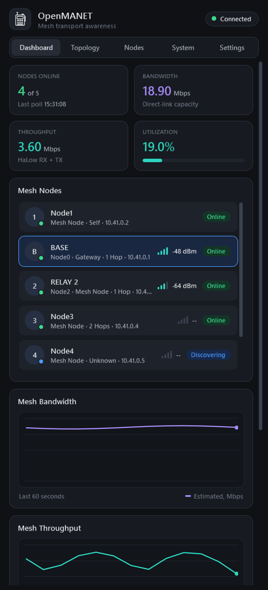
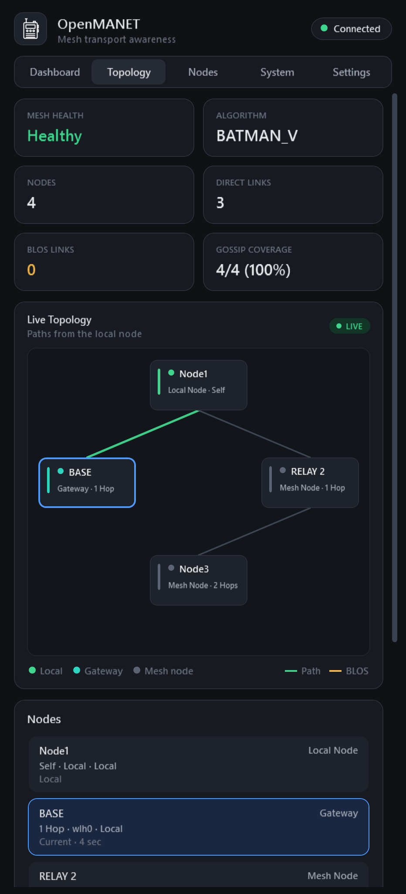
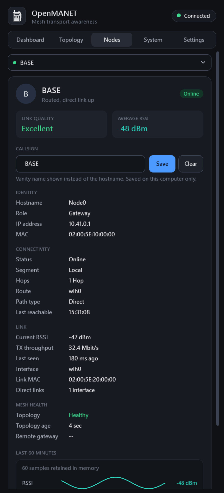
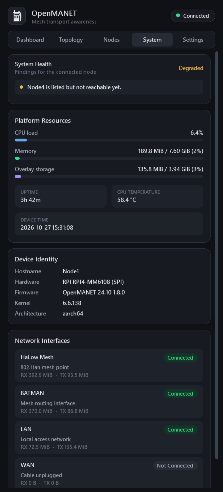
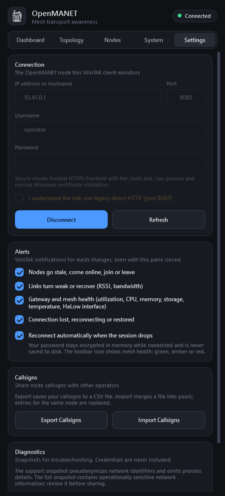

# OpenMANET for WinTAK

A WinTAK plugin for monitoring an OpenMANET HaLow mesh from a WinTAK client. It shows mesh nodes, link quality, topology, gateway health and mesh events in a docked pane.

- **Dashboard:** nodes online, mesh bandwidth, throughput and utilization, plus the node list and a mesh event log.
- **Topology:** a live map of nodes and links from the connected node, including BLOS links.
- **Nodes:** per-node link quality, RSSI, routing details, 60-minute trends, and optional vanity callsigns. Callsigns are saved locally and shown in place of hostnames; export and import them as CSV to share with your team.
- **System:** health findings, CPU, memory, storage and temperature, and network interfaces on the connected node.
- **Alerts:** WinTAK notifications when nodes go stale or come back, links weaken, gateway health changes, or the connection drops. Pick which in Settings. The OpenMANET toolbar icon shows a green, amber or red health dot, so you can see the mesh state with the pane closed.
- **Auto-reconnect:** after a node reboot or an expired session, the plugin signs back in on its own, waiting a little longer between each attempt. It stops if the password is rejected.
- **Diagnostics:** redacted or full snapshots for troubleshooting. Credentials are never included.

## Screenshots

<table>
  <tr>
    <td align="center"><br><b>Dashboard</b></td>
    <td align="center"><br><b>Topology</b></td>
    <td align="center"><br><b>Nodes</b></td>
  </tr>
  <tr>
    <td align="center"><br><b>System</b></td>
    <td align="center"><br><b>Settings</b></td>
    <td></td>
  </tr>
</table>

<sub>Screenshots use sample data. Node names, callsigns, addresses and MACs are illustrative.</sub>

Node status:

| Status | Meaning |
| --- | --- |
| Online | Reachable over a route, or heard on a direct RF link within the last 15 s |
| Discovering | Listed by the mesh but not reachable yet, usually right after a node boots |
| Stale | Was online, but has gone quiet (a direct neighbor unheard for over 30 s) |

## Requirements

- WinTAK 5.7.0.144 (x64)
- An OpenMANET node reachable from the WinTAK machine. HTTPS on port 8081 is the default; legacy HTTP on port 8087 is available as an opt-in.

## Install

1. Download `OpenMANET-<version>-5.7.0.144.wpk` from the repository's Releases page.
2. Close WinTAK, then install the `.wpk` package in WinTAK.
3. Start WinTAK, open the OpenMANET pane, then enter the node address and credentials under **Settings**.

When upgrading, remove the old `WinTAK_OpenMANET_Plugin.dll` from `%APPDATA%\WinTAK\Plugins` first, and restart WinTAK completely.

## Build

You need the .NET SDK and WinTAK 5.7.0.144 installed (the build references its SDK assemblies).

```powershell
.\build.ps1                                # default WinTAK path: C:\Program Files\WinTAK
.\build.ps1 -WinTakDir "D:\WinTAK"         # custom install location
```

The package is written to `dist\OpenMANET-<version>-<sdk>.wpk`. Versions come from `src/Properties/AssemblyInfo.cs`.

After UI changes, regenerate the README screenshots with `.\docs\render-screenshots.ps1`. It renders the built plugin with sample data, so no real network details end up in the images.
